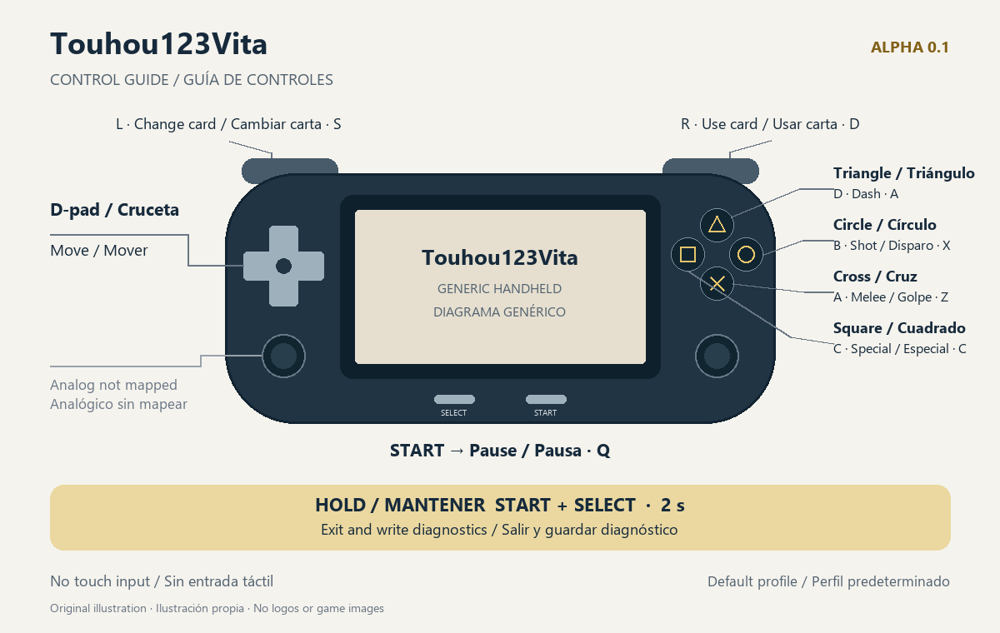

# Touhou123Vita — alpha 0.1

## English

A fan-made PS Vita port of **Touhou 12.3 Hisoutensoku 1.10a**, using static recompilation: **x86 → C → ARM**. This is an experimental alpha, not a finished game. The release is **source-only**: no VPK, translated game code, game files or third-party binaries are distributed. Build your own VPK locally using your own game files.

Hardware reports include title/menu navigation and playable fights, with approximately 39 seconds to the title and 50–59 FPS in some fight intervals using adaptive frame skip. These are historical measurements, not guarantees for this build. Long-session freezes and degraded audio remain open. Story and Arcade completion, and English presentation on hardware, are **unverified**. See the [alpha roadmap](docs/ROADMAP.md) and [release notes](docs/RELEASE_NOTES_0.1.md).

### Requirements

- Your own lawful copy of Hisoutensoku **1.10a**: `th123.exe`, `th123a.dat`, `th123b.dat`, `th123c.dat`.
- Required SHA-256 for `th123.exe`: `f0db93660ceb8635a1921e0ba4686fcfbd5c492311dee6ef7061b7bada16731e`.
- Optional: your own `th123e.dat` from unofficial English patch **v1.1a**. Phase 1 replaces 426 resources (images, tables and scripts); English fonts, about 80 executable strings and patch layout changes are still pending. Do not install or run the Windows patch launcher on Vita.
- A PS Vita with HENkaku/Ensō and VitaShell. Maximum supported clock settings are recommended for this alpha; the reported hardware measurements used maximum overclock settings.
- vitaGL requires your own `ur0:data/libshacccg.suprx`; it is not provided here. Vita3K is **unsupported** for alpha 0.1.

### Build on Windows

Use PowerShell 7 and Python 3.12. Install MSYS2 UCRT64 GCC at `C:/msys64/ucrt64/bin/gcc.exe` (the host builder currently uses that path), plus SDL2, FreeType, libpng, Vorbis/Ogg and their static link dependencies. The exact libraries are listed in `recomp/build_host.py`. Install VitaSDK at `C:/vitasdk`, with vitaGL, vitaShaRK, mathneon, taihen and SceShaccCgExt and their VitaSDK dependencies. Native game libraries are built by [third_party/vita-libs/build.ps1](third_party/vita-libs/README.md); no binary libraries are committed.

From the repository root (replace the source folder below with your own):

```powershell
$env:VITASDK = 'C:\vitasdk'
$env:PATH = 'C:\msys64\ucrt64\bin;' + $env:PATH
python -m pip install --target local/python-deps pefile capstone unicorn Pillow
$env:PYTHONPATH = (Join-Path $PWD 'local/python-deps')
New-Item -ItemType Directory -Force original | Out-Null
$gameSource = 'D:\YourGame'
foreach ($name in 'th123.exe','th123a.dat','th123b.dat','th123c.dat') {
    Copy-Item -LiteralPath (Join-Path $gameSource $name) -Destination original
}
(Get-FileHash original/th123.exe -Algorithm SHA256).Hash
./third_party/vita-libs/build.ps1 -VitaSDK $env:VITASDK
python recomp/discover.py
python recomp/lift_all.py
python recomp/build_host.py --jobs 4
python recomp/build_vita.py --jobs 4
```

`discover.py` must run before the first `lift_all.py`. The commands above are checked against the scripts' argument parsers; they were **not rebuilt for this documentation change**. A cold Vita build takes approximately **70 minutes**, depending on the machine. `build_vita.py` defaults to `-O2`. Reusing the object cache reduces subsequent build times. The generated C and all local outputs belong under ignored `artifacts/`.

Your locally built package is:

```text
artifacts/recomp/f0db93660ceb8635a1921e0ba4686fcfbd5c492311dee6ef7061b7bada16731e/vita/T123Recomp.vpk
```

For a PC check, `python recomp/build_host.py --run --jobs 4` starts the host with `original/` as its game data directory. The native library build requires `tar` and downloads pinned sources; see its README for offline reuse and smoke tests.

### Install and play

Transfer **your locally built VPK** and install it using VitaShell. Copy your game files to:

```text
ux0:data/touhou123vita/
  th123.exe
  th123a.dat
  th123b.dat
  th123c.dat
  th123e.dat       (optional, supplied by you)
```

The first launch with `th123e.dat` generates `th123e.cache` in the same directory and may take longer. Keep the cache local. If replacing the patch, remove the old cache so it can be rebuilt. Do not commit or upload either file.



| Control | Action | Default keyboard key |
|---|---|---|
| D-pad | Move | Arrow keys |
| Cross | A / melee | Z |
| Circle | B / shot | X |
| Square | C / special | C |
| Triangle | D / dash | A |
| L | Change card | S |
| R | Use card | D |
| START | Pause | Q |
| START + SELECT, held for 2 seconds | Exit and write diagnostics | — |

The analog stick and touch are not mapped. The mapping is verified in `recomp/host/input_map.c`; the exit chord is in `recomp/host/render_gl.c`. Custom in-game keyboard profiles may change the resulting actions.

### Diagnostics and known issues

Exit with **START + SELECT for 2 seconds** to write `recomp-trace.log` and `recomp-result.txt` in the data directory. Keep these local and inspect them before sharing. To compare audio with the translated decoder, create an empty **`guest-vorbis.txt`** in that directory and restart; remove it and restart to use native Vorbis again.

Known issues include black-screen freezing after 5–6 matches (reported, reproduction unverified here), degraded audio and slowdown in the latest reported test, occasional asynchronous texture-compression failures, missing card actions 807/820 that use the nearest lower available action, incomplete English fonts/EXE strings/layout, no supported netplay, no mapped analog stick or touch, and no supported local two-player mode. See the [roadmap](docs/ROADMAP.md) for evidence and next steps.

This is a fan project, not affiliated with **Team Shanghai Alice** or **Twilight Frontier**. It does not distribute game content. Game ownership does not grant redistribution rights: keep the original files, extracted resources, generated C, VPK and third-party binaries private.

## Español

Port de fans para PS Vita de **Touhou 12.3 Hisoutensoku 1.10a**, mediante recompilación estática **x86 → C → ARM**. Es una alpha experimental. La publicación contiene **solo fuentes propios**: no incluye VPK, código traducido del juego, recursos ni bibliotecas binarias. Compila tu VPK localmente con tu copia del juego.

Hay informes de título, menús y peleas jugables: unos 39 s hasta el título y tramos de 50–59 FPS con frame skip adaptativo. Son mediciones históricas, no garantías de este build. Persisten congelaciones largas y audio degradado. Completar Story/Arcade y la presentación inglesa en consola quedan **sin verificar**. Consulta el [roadmap alpha](docs/ROADMAP.md) y las [notas](docs/RELEASE_NOTES_0.1.md).

### Requisitos y compilación

Necesitas tu copia legal **1.10a** (`th123.exe` y `th123a/b/c.dat`), con el SHA-256 indicado arriba. Opcionalmente, tu `th123e.dat` del parche inglés **v1.1a**: sustituye 426 recursos; faltan fuentes, unas 80 cadenas del EXE y ajustes de diseño.

La consola requiere HENkaku/Ensō, VitaShell y tu `ur0:data/libshacccg.suprx`. Se recomienda el máximo overclock admitido; las mediciones publicadas usaron los máximos ajustes. **Vita3K no está soportado** en esta alpha.

En Windows usa PowerShell 7, Python 3.12, GCC de MSYS2 UCRT64, SDL2, FreeType, PNG/Vorbis/Ogg y sus dependencias estáticas para PC; VitaSDK y las dependencias vitaGL/vitaShaRK/mathneon/taihen/SceShaccCgExt para Vita. Ejecuta el bloque PowerShell de la sección inglesa desde la raíz: instala pefile, capstone, unicorn y Pillow en `local/python-deps`, copia tus archivos a `original/`, construye `third_party/vita-libs`, ejecuta `discover.py`, `lift_all.py`, `build_host.py` y `build_vita.py`, en ese orden. Los argumentos se comprobaron leyendo los scripts; no se recompiló el juego en esta tarea. La compilación Vita desde cero tarda aproximadamente **70 minutos**. El VPK queda en la ruta local indicada arriba.

### Instalación y controles

Instala **tu VPK local** con VitaShell. Copia el EXE y los tres DAT a **`ux0:data/touhou123vita/`**. El `th123e.dat` opcional va en esa misma carpeta; el primer arranque genera `th123e.cache`. Si cambias el parche, borra la caché anterior para regenerarla.

| Botón | Acción | Tecla predeterminada |
|---|---|---|
| Cruceta | Mover | Flechas |
| Cruz | A / golpe | Z |
| Círculo | B / disparo | X |
| Cuadrado | C / especial | C |
| Triángulo | D / dash | A |
| L | Cambiar carta | S |
| R | Usar carta | D |
| START | Pausa | Q |
| START + SELECT, 2 segundos | Salir y guardar diagnóstico | — |

El stick analógico y el táctil no están mapeados. Los perfiles personalizados pueden cambiar las acciones. [Diagrama vectorial](docs/img/controls.svg).

### Diagnóstico, límites y aviso legal

Al salir con START+SELECT se escriben `recomp-trace.log` y `recomp-result.txt` en la carpeta de datos. Para comparar el audio, crea allí un archivo vacío `guest-vorbis.txt` y reinicia: vuelve al decodificador traducido. Bórralo y reinicia para recuperar Vorbis nativo.

Problemas abiertos: congelación negra reportada tras 5–6 partidas, audio degradado y lentitud en la última prueba reportada, posible carrera de compresión asíncrona, respaldo de acciones de carta 807/820 a la acción inferior, traducción incompleta y ausencia de netplay, stick/táctil y dos jugadores locales soportados. La reproducción de esos informes no se verificó en esta tarea. Prioridades: estabilidad, audio, fuentes inglesas, cadenas del EXE y rendimiento.

Proyecto de fans **no afiliado a Team Shanghai Alice ni a Twilight Frontier**. No distribuye contenido del juego. No publiques EXE/DAT, recursos extraídos, C generado, VPK ni binarios ajenos.

[Arquitectura y roadmap técnico](docs/ROADMAP_RECOMP.md) · [Evidencia PC/Vita](docs/H2_PC_TITLE.md) · [Roadmap histórico de reimplementación](docs/ROADMAP_REIMPLEMENTATION.md)
