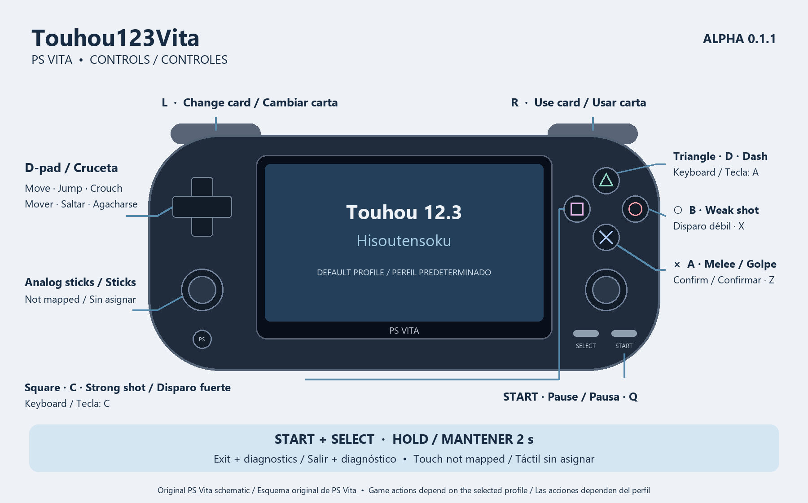

# Touhou123Vita — alpha 0.1.1
**ULTRA IA VIBECODED!**
**Touhou 12.3: Hisoutensoku for PS Vita / para PS Vita** · Static recompilation / Recompilación estática (x86 → C → ARM).

[Español](#español) · [English](#english) · [Download VPK / Descargar VPK](https://github.com/Botarguirix/Touhou123Vita/releases/tag/v0.1.1-alpha)



## Español

### Aviso contra la piratería

**Este proyecto NO condona, promueve ni facilita la piratería. Debes adquirir y utilizar tu propia copia legal de Touhou 12.3: Hisoutensoku.** Busca el juego por canales de venta autorizados por sus creadores; aquí no se proporcionan enlaces a copias no autorizadas, EXE, DAT ni parches con contenido del juego. No solicites ni compartas esos archivos en este repositorio.

Proyecto de fans no afiliado a **Team Shanghai Alice, Twilight Frontier ni Sony**. El VPK publicado contiene código traducido del ejecutable original; **no incluye el EXE de Windows ni los DAT del juego** y no funciona por sí solo. Los derechos del juego pertenecen a sus titulares. Tener una copia no concede permiso para redistribuir sus archivos.

### Qué necesitas para jugar

| Requisito | Detalle |
|---|---|
| Consola | PS Vita preparada para ejecutar homebrew (HENkaku/Ensō según tu instalación) y VitaShell para instalar el VPK y copiar archivos. |
| Port | [Touhou123Vita alpha 0.1.1](https://github.com/Botarguirix/Touhou123Vita/releases/tag/v0.1.1-alpha). No necesitas VitaSDK ni compilar para instalar este VPK. |
| Juego | **Touhou 12.3: Hisoutensoku, versión japonesa original 1.10a**, de tu copia legal. La versión 1.01 y los ejecutables modificados no son la entrada compatible. |
| Archivos obligatorios | `th123.exe`, `th123a.dat`, `th123b.dat` y `th123c.dat` de esa instalación. **También necesitas el EXE en la Vita**, aunque instales el VPK. |
| Compilador de shaders | Tu módulo `libshacccg.suprx` instalado en **`ur0:data/libshacccg.suprx`**. vitaGL lo necesita; no se distribuye aquí. |
| Almacenamiento | Espacio para instalar el VPK (aprox. 24,3 MB de descarga), copiar el EXE y los DAT y guardar perfiles, registros y cachés. El espacio total depende de tus archivos. |

**Cómo comprobar la versión:** el SHA-256 exacto del `th123.exe` compatible es:

```text
f0db93660ceb8635a1921e0ba4686fcfbd5c492311dee6ef7061b7bada16731e
```

En PowerShell de Windows, compruébalo **antes de copiarlo**:

```powershell
Get-FileHash 'D:\TuJuego\th123.exe' -Algorithm SHA256
```

Debe coincidir con el hash anterior (mayúsculas/minúsculas no importan). Conserva el EXE original 1.10a: no lo sustituyas por un launcher del parche inglés o por un ejecutable modificado.

### Instalación paso a paso

1. Descarga `Touhou123Vita-alpha-0.1.1.vpk` de la release e instálalo con VitaShell. Antes de actualizar, haz una copia de seguridad de tus perfiles y de la carpeta de datos.
2. En VitaShell, crea **`ux0:data/touhou123vita/`** y copia directamente dentro los cuatro archivos obligatorios de tu instalación legal. No los dejes dentro de otra subcarpeta ni dentro de un ZIP.
3. Comprueba que tu módulo de shaders está en **`ur0:data/libshacccg.suprx`** (es `ur0:`, no `ux0:`).
4. Abre **Touhou12.3Vita Hisoutensoku** desde LiveArea. La carga inicial puede tardar; esta alpha no garantiza cargas rápidas ni rendimiento constante.
5. Usa la cruceta y **Cruz (×)** para navegar y confirmar; **Círculo (○)** para cancelar/volver donde lo permita el menú. Empieza por Vs Com. Consulta los controles de abajo.

Estructura de datos:

```text
ux0:data/touhou123vita/
├── th123.exe          # obligatorio: original 1.10a, hash indicado arriba
├── th123a.dat         # obligatorio
├── th123b.dat         # obligatorio
├── th123c.dat         # obligatorio
├── th105a.dat         # opcional: de tu copia legal de Touhou 10.5
├── th105b.dat         # opcional: de tu copia legal de Touhou 10.5
├── configex123.ini    # vinculación / linking: [th105path], path=./
└── th123e.dat         # opcional: recursos de tu parche inglés v1.1a

ur0:data/libshacccg.suprx
```

**Touhou 10.5 (Scarlet Weather Rhapsody):** si tienes una copia legal y necesitas sus recursos heredados, copia también `th105a.dat` y `th105b.dat` a la misma carpeta. No vienen incluidos; no se garantiza aquí el roster completo sin esos datos.

**Inglés opcional:** el port reconoce `th123e.dat` del parche inglés **v1.1a** del usuario. No ejecutes el instalador/launcher de Windows en Vita. La traducción es parcial, no una garantía de todos los textos en inglés. El primer arranque genera `th123e.cache` y puede tardar más; si sustituyes el parche, elimina solo esa caché para regenerarla.

### Personajes de 12.3 + 10.5: vinculación (el «parche» del roster)

Para usar los personajes y escenarios heredados de **Touhou 10.5: Scarlet Weather Rhapsody**, necesitas **copias legales de ambos juegos**. La integración pertenece al juego original: [Twilight Frontier explica que Hisoutensoku utiliza esos personajes y escenarios cuando encuentra la instalación de 10.5](https://tasofro.net/touhou123/). **No es el parche inglés `th123e.dat` ni un parche de desbloqueo que se incluya en este repositorio.**

**Actualizaciones oficiales (se aplican en Windows a los juegos completos, no en Vita):** [12.3 → 1.10a, `th123_update_110a.exe`](https://tasofro.net/touhou123/download.html) y [10.5 → 1.06a, `th105_update_106a.exe`](https://tasofro.net/touhou105/download.html). Prepara 10.5 con su actualización oficial 1.06a; esto identifica la versión de preparación recomendada, no una prueba nueva de compatibilidad del port. Los actualizadores no contienen el juego completo ni sustituyen su compra.

1. En PC, prepara tu instalación legal de Hisoutensoku **1.10a** y tus datos de Scarlet Weather Rhapsody. Usa las actualizaciones oficiales del desarrollador para tus copias; no un EXE modificado ni un paquete de personajes descargado de terceros.
2. Copia `th105a.dat` y `th105b.dat` a **`ux0:data/touhou123vita/`**, junto a los archivos de 12.3. Si tu instalación actualizada también contiene `th105c.dat`, conserva y copia ese archivo igualmente. **Para la integración del roster, los datos de 10.5 sí son necesarios**, aunque sean opcionales para iniciar 12.3 por separado.
3. Copia también `configex123.ini` de tu instalación de 12.3 a esa carpeta. Edita únicamente su sección de ruta de 10.5 para que busque en la misma carpeta:

```ini
[th105path]
path=./
```

4. Guarda el archivo como `configex123.ini` (no `.ini.txt`) y reinicia el port. No conserves una ruta absoluta de Windows como `C:\Program Files\...` dentro de esa sección.

Esta configuración coincide con los archivos locales y la traducción de rutas del port. **No se volvió a verificar el desbloqueo de todos los personajes en una PS Vita durante esta actualización de documentación**, ni se validó aquí una versión concreta de los DAT de 10.5; no se presenta como un parche universal ni como garantía de un roster sin fallos.

### Controles detallados — perfil predeterminado

| Botón PS Vita | Combate / función | Tecla que recibe el juego |
|---|---|---|
| Cruceta ← / → | Caminar; mantener la dirección opuesta al rival para bloquear cuando el estado del personaje lo permita | ← / → |
| Cruceta ↑ / ↓ | Saltar / agacharse; también navegar por menús | ↑ / ↓ |
| Cruz × | **A**: ataque cuerpo a cuerpo; confirmar en menús | Z |
| Círculo ○ | **B**: proyectil débil; cancelar/volver en menús | X |
| Cuadrado □ | **C**: proyectil fuerte | C |
| Triángulo △ | **D**: dash / vuelo, según dirección y estado | A |
| L | Cambiar la carta seleccionada | S |
| R | Usar la carta seleccionada cuando se cumplan sus condiciones | D |
| START | Pausa del combate; no equivale a Escape en todos los menús | Q |
| SELECT | Sin acción individual asignada por el port | — |
| START + SELECT, mantener 2 segundos | Salir de la ejecución y guardar diagnóstico | Atajo propio del port |
| Sticks analógicos y superficies táctiles | Sin asignación | — |

Los comandos especiales combinan direcciones con A/B/C/D según el personaje. **No hay un botón dedicado a guardia**. Un perfil de teclado personalizado puede cambiar las acciones resultantes: el port envía las teclas de la tabla. Mapeo comprobado en [`input_map.c`](recomp/host/input_map.c); atajo de salida en [`render_gl.c`](recomp/host/render_gl.c).

### Estado y solución de problemas

Es una **alpha experimental**, no un port terminado. Hay informes de título, menús y combates en hardware; persisten problemas de audio, rendimiento y estabilidad. Completar Story/Arcade no está verificado para este paquete. Netplay, dos jugadores locales, sticks y táctil no están soportados; Vita3K no es una plataforma de juego soportada para esta alpha.

- **No arranca / error al cargar el juego:** revisa los cuatro archivos obligatorios, su carpeta y el hash del EXE; comprueba también el módulo de shaders.
- **Acciones distintas a la tabla:** revisa las asignaciones de teclado de tu perfil del juego.
- **Para informar de un fallo:** mantén START+SELECT durante 2 s. Revisa `recomp-trace.log` y `recomp-result.txt` en la carpeta de datos antes de compartirlos; no adjuntes EXE/DAT ni cachés de recursos.

El VPK 0.1.1 se publicó a partir del paquete local existente: pasó las comprobaciones de estructura/CRC, sin nueva prueba en consola ni recompilación independiente. Su versión interna sigue siendo `00.01`; el número de la release es `v0.1.1-alpha`.

## English

### Anti-piracy notice
**ULTRA IA VIBECODED!**
**This project does NOT condone, promote or facilitate piracy. You must obtain and use your own legally purchased copy of Touhou 12.3: Hisoutensoku.** Obtain the game through sales channels authorized by its creators. This repository provides no links to unauthorized game copies, EXE/DAT files or patches containing game content. Do not request or share those files here.

This fan project is not affiliated with **Team Shanghai Alice, Twilight Frontier or Sony**. The published VPK contains code translated from the original executable; **it does not include the Windows EXE or game DAT files** and cannot run by itself. All game rights belong to their respective owners. Owning a copy does not grant permission to redistribute its files.

### What you need to play

| Requirement | Details |
|---|---|
| Console | A homebrew-enabled PS Vita (HENkaku/Ensō as appropriate for your setup), with VitaShell to install the VPK and transfer files. |
| Port | [Touhou123Vita alpha 0.1.1](https://github.com/Botarguirix/Touhou123Vita/releases/tag/v0.1.1-alpha). Installing this VPK does not require VitaSDK or compiling the port. |
| Game | Your lawful copy of **Touhou 12.3: Hisoutensoku, original Japanese version 1.10a**. Version 1.01 and modified executables are not compatible inputs. |
| Required files | `th123.exe`, `th123a.dat`, `th123b.dat` and `th123c.dat` from that installation. **The EXE must also be copied to the Vita**, even when using the prebuilt VPK. |
| Shader compiler | Your own `libshacccg.suprx` at **`ur0:data/libshacccg.suprx`**, required by vitaGL; not supplied here. |
| Storage | Room for the VPK installation (about 24.3 MB download), your EXE/DAT files, profiles, logs and caches. Total space depends on your files. |

**Required game version:** the original `th123.exe` **1.10a** must have this exact SHA-256:

```text
f0db93660ceb8635a1921e0ba4686fcfbd5c492311dee6ef7061b7bada16731e
```

Check it in Windows PowerShell **before copying** (letter case does not matter):

```powershell
Get-FileHash 'D:\YourGame\th123.exe' -Algorithm SHA256
```

Keep the original 1.10a executable; do not replace it with an English patch launcher or a modified EXE.

### Installation

1. Download `Touhou123Vita-alpha-0.1.1.vpk` from the release and install it with VitaShell. Back up your profiles and data directory before updating.
2. Create **`ux0:data/touhou123vita/`** and copy the four required files from your lawful game installation directly into it. Do not put them in an extra subfolder or ZIP archive.
3. Verify your shader compiler is at **`ur0:data/libshacccg.suprx`** (`ur0:`, not `ux0:`).
4. Launch **Touhou12.3Vita Hisoutensoku** from LiveArea. Initial loading may take a while; this alpha does not guarantee fast loading or consistent performance.
5. Navigate with the D-pad, confirm with **Cross (×)** and cancel/go back with **Circle (○)** where supported by the menu. Start with Vs Com.

```text
ux0:data/touhou123vita/
├── th123.exe          # required: original 1.10a, SHA-256 above
├── th123a.dat         # required
├── th123b.dat         # required
├── th123c.dat         # required
├── th105a.dat         # optional: from your lawful Touhou 10.5 copy
├── th105b.dat         # optional: from your lawful Touhou 10.5 copy
├── configex123.ini    # vinculación / linking: [th105path], path=./
└── th123e.dat         # optional: from your English patch v1.1a

ur0:data/libshacccg.suprx
```

**Touhou 10.5 (Scarlet Weather Rhapsody):** if you own a lawful copy and need its inherited resources, also copy `th105a.dat` and `th105b.dat` into the same data directory. They are not supplied; the full roster without those files is not guaranteed here.

**Optional English resources:** the port recognizes the user's `th123e.dat` from English patch **v1.1a**. Do not run the Windows patch installer/launcher on Vita. Translation support is partial; not every screen or string is guaranteed to be in English. First launch generates `th123e.cache` and may take longer. When replacing the patch, delete only that cache to rebuild it.

### Characters from 12.3 + 10.5: linking the roster

To use inherited characters and stages from **Touhou 10.5: Scarlet Weather Rhapsody**, you need **lawful copies of both games**. This is an original game feature: [Twilight Frontier documents linking Hisoutensoku to the 10.5 installation](https://tasofro.net/touhou123/). **It is separate from the `th123e.dat` English patch; no character unlock patch is bundled here.**

**Official updates (run on Windows against the full games, not on Vita):** [12.3 → 1.10a, `th123_update_110a.exe`](https://tasofro.net/touhou123/download.html) and [10.5 → 1.06a, `th105_update_106a.exe`](https://tasofro.net/touhou105/download.html). Prepare 10.5 with its official 1.06a update; this is the recommended preparation version, not a new port compatibility test. Updaters do not contain the full games or replace purchasing them.

1. On PC, prepare your lawful Hisoutensoku **1.10a** installation and Scarlet Weather Rhapsody data. Use the developer's official updates for your copies, rather than modified executables or third-party character packs.
2. Copy `th105a.dat` and `th105b.dat` into **`ux0:data/touhou123vita/`**, alongside the 12.3 files. If your updated installation also has `th105c.dat`, preserve and copy it too. **10.5 data is required for this roster integration**, even though it is optional for launching standalone 12.3.
3. Also copy `configex123.ini` from your 12.3 installation into that directory. Change only its 10.5 path section to use the same directory:

```ini
[th105path]
path=./
```

4. Save it as `configex123.ini` (not `.ini.txt`) and restart the port. Do not leave an absolute Windows path such as `C:\Program Files\...` in this section.

This setup matches the local files and the port's path translation. **Unlocking every character was not retested on PS Vita for this documentation update**, and no specific version of the 10.5 DAT files was validated here. This is not presented as a universal patch or a guarantee of a bug-free full roster.

### Detailed controls — default profile

| PS Vita control | Combat / function | Keyboard input sent to game |
|---|---|---|
| D-pad ← / → | Walk; hold away from the opponent to block when the character state allows it | ← / → |
| D-pad ↑ / ↓ | Jump / crouch; also navigate menus | ↑ / ↓ |
| Cross × | **A**: melee attack; confirm in menus | Z |
| Circle ○ | **B**: weak projectile; cancel/back in menus | X |
| Square □ | **C**: strong projectile | C |
| Triangle △ | **D**: dash / flight depending on direction and state | A |
| L | Change selected card | S |
| R | Use selected card when its conditions are met | D |
| START | Pause during combat; does not act as Escape in every menu | Q |
| SELECT | No individual action assigned by the port | — |
| START + SELECT, hold for 2 seconds | Exit the run and write diagnostics | Port shortcut |
| Analog sticks and touch surfaces | Not mapped | — |

Special moves combine directions and A/B/C/D according to the character. **There is no dedicated guard button.** Custom keyboard profiles may change the resulting actions: the port sends the keys shown above. See [`input_map.c`](recomp/host/input_map.c) and the exit shortcut in [`render_gl.c`](recomp/host/render_gl.c).

### Status and troubleshooting

This is an **experimental alpha**, not a finished port. Hardware reports include title/menu navigation and fights; audio, performance and stability problems remain. Story/Arcade completion is unverified for this package. Netplay, local two-player mode, analog sticks and touch controls are unsupported; Vita3K is not a supported play platform for this alpha.

- **Startup/game loading errors:** check all four required files, their directory, the EXE hash and the shader compiler module.
- **Unexpected controls:** check your in-game profile's keyboard bindings.
- **Bug reports:** hold START+SELECT for 2 seconds. Inspect `recomp-trace.log` and `recomp-result.txt` in the data directory before sharing; do not attach EXE/DAT files or resource caches.

The 0.1.1 VPK is the existing local package, validated for structure/CRC without a new console test or independent rebuild. Its internal app version remains `00.01`; the release version is `v0.1.1-alpha`.

## Desarrollo / Development

La ruta vigente es la recompilación estática; las instrucciones de la antigua demo no aplican al VPK actual. / The current route is static recompilation; old demo instructions do not apply to the current VPK.

- [Pipeline de recompilación / Recompilation pipeline](recomp/README.md)
- [Arquitectura y roadmap / Architecture and roadmap](docs/ROADMAP_RECOMP.md)
- [Evidencia PC y Vita / PC and Vita evidence](docs/H2_PC_TITLE.md)
- [Inventario del EXE / EXE inventory](docs/PE_INVENTORY.md)
- [Historial de la reimplementación congelada / Frozen reimplementation history](legacy/README.md)

El repositorio contiene las herramientas y capas propias; EXE/DAT originales, recursos extraídos y C generado permanecen fuera de Git. / The repository contains the project's tools and platform layers; original EXE/DAT files, extracted resources and generated C stay out of Git.
