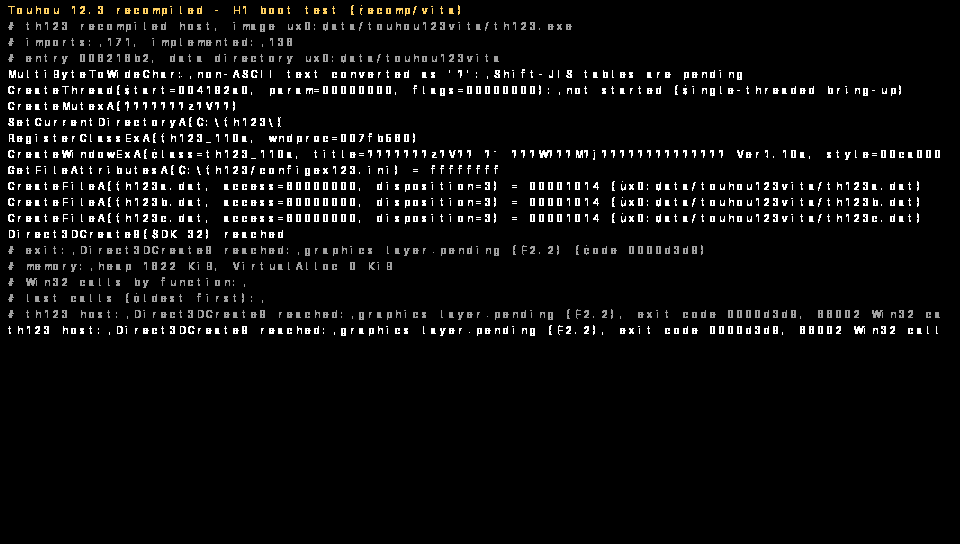

# H1 / F3.0: el código recompilado del juego corre en ARM (Vita3K)

Fecha: 21 de octubre de 2026. Primer hito visible del [roadmap](ROADMAP_RECOMP.md).

**Resultado:** el mismo C generado a partir de `th123.exe`, compilado para ARM con VitaSDK, arranca en Vita3K. Ejecuta el CRT de MSVC y `WinMain`, crea la ventana del juego, abre y parsea `th123a/b/c.dat` desde `ux0:data/touhou123vita/` y llega a `Direct3DCreate9`. **La traza de Vita3K es idéntica línea a línea a la de PC**: 232 líneas, 0 diferencias tras normalizar rutas y tiempos, con las mismas 88 002 llamadas Win32 y el mismo heap de 1 822 KiB.



```powershell
python recomp/lift_all.py                 # C generado (una vez)
python recomp/build_vita.py               # VPK: artifacts/recomp/<sha>/vita/T123Recomp.vpk
./tools/vita3k-recomp.ps1                 # instala, ejecuta en Vita3K y recoge resultados
```

## Cifras

| Medida | Valor |
|---|---|
| Compilación ARM (VitaSDK gcc 15.2, `-O1`) | 77 objetos en 474 s con 8 hilos; después solo se recompila lo que cambia |
| Código ARM | 19 514 KiB de `.text`; `eboot.bin` comprimido de 8 743 KiB |
| VPK | 8,7 MB, **sin datos del juego**: código, fuente generada localmente y LiveArea |
| Tiempo hasta `Direct3DCreate9` | 44 ms en PC (x86-64 nativo); 537–551 ms en Vita3K |
| Memoria guest | Ventana única de 128 MiB (`sceKernelAllocMemBlock`); heap usado 1 822 KiB |

El tiempo en Vita3K **no mide el hardware**: Vita3K traduce ARM al x86 del PC. La primera medida de rendimiento real necesita una Vita (ver abajo).

## Qué cambió para ARM

- **Mapa de memoria guest compacto, igual en PC y Vita**: pila `0x110000`, imagen `0x400000`, TIB/PEB `0x900000`, heap `0x1000000` (96 MiB) y `VirtualAlloc` `0x7000000` (16 MiB), todo por debajo de `GUEST_WINDOW` = 128 MiB. En Vita es un solo bloque de memoria; en PC se sigue reservando el rango de 4 GiB para que un acceso fuera de lugar falle. Las direcciones falsas de funciones y módulos están fuera de la ventana: se llaman y se comparan, nunca se leen.
- **Plataforma separada** (`recomp/host/platform_pc.c` y `recomp/vita/platform_vita.c`): tiempo en microsegundos (`sceKernelGetProcessTimeWide` en Vita) y registro en pantalla. Al terminar se escriben `recomp-result.txt` y una captura BMP en `ux0:data/touhou123vita/`. El resto del host es C portable sin cambios.
- **Pila del hilo principal de 8 MiB** (`sceUserMainThreadStackSize`) para las cadenas de llamadas guest.
- `Direct3DCreate9` **detiene** la ejecución con un motivo claro, en vez de devolver NULL como en F2.0. En la Vita la página guest 0 está dentro de la ventana, así que el camino de error del juego divergiría del de PC; parar en el mismo punto hace comparables las dos plataformas.
- La traza se cierra antes de `sceKernelExitProcess`: la Vita no vacía los búferes de `stdio` al salir. La primera ejecución perdió el final de la traza por eso.

## Cómo probarlo en una Vita real

1. Instalar `artifacts/recomp/<sha>/vita/T123Recomp.vpk` con VitaShell (Title ID `THSV12302`, convive con la demo legacy `THSV12301`).
2. Copiar a `ux0:data/touhou123vita/` **tu** `th123.exe` 1.10a (SHA-256 `f0db9366…a16731e`) y `th123a.dat`, `th123b.dat`, `th123c.dat`.
3. Abrir la aplicación. Muestra el progreso en pantalla y, a los 5 segundos de terminar, se cierra sola. Después quedan `recomp-result.txt`, `recomp-trace.log` y `recomp-screen.bmp` en la misma carpeta. El tiempo de `recomp-result.txt` es la **primera medida de rendimiento real del código traducido** en el Cortex-A9.

## Límites

- Todavía no hay gráficos ni entrada: se detiene en D3D por diseño.
- El hilo que el juego crea al arrancar (`0x4192a0`) todavía no se ejecuta.
- Los textos Shift-JIS se ven como `?` en esta pantalla de depuración (la fuente es ASCII) y en las conversiones de `MultiByteToWideChar`.
- No se ha probado en hardware real: el VPK está listo, pero esta máquina solo tiene Vita3K.

## Siguiente

H2 en PC: F2.1 (hilos reales, mensajes de ventana hacia la wndproc `0x7fb560`) y F2.2 (D3D9 sobre OpenGL/SDL2, con el alcance que mida la tarea T3 de Codex), hasta la pantalla de título. El build de Vita sigue al día en paralelo, para detectar pronto lo que solo falle en ARM.
